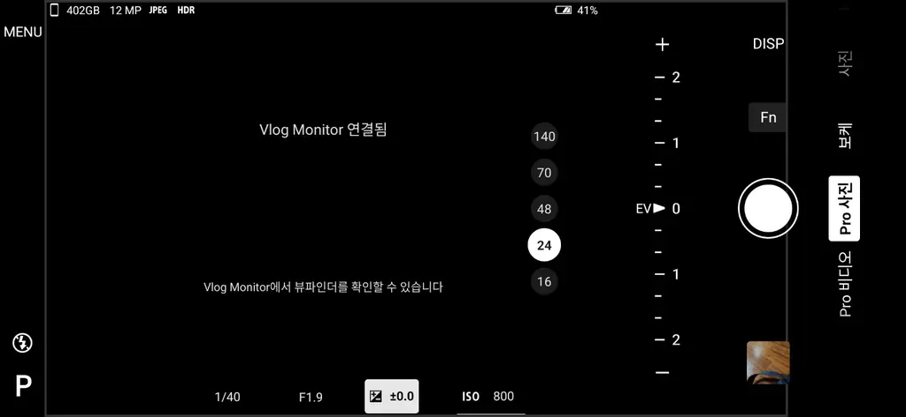

# Xperia 1 VIII Camera — Sony Vlog Monitor XQZ-IV01

*Xperia 1 VIII Camera — Sony Vlog Monitor XQZ-IV01 connected (실제 연결 완료 화면)*

**Unofficial Xperia camera compatibility modification by Sony KR Users Community (소니 KR 사용자모임, Korea)**

> English first / 한국어 안내는 아래에 있습니다.

## English

### About this app

This separately installable Xperia 1 VIII Camera APK enables connection with the **genuine Sony Vlog Monitor for Xperia, model XQZ-IV01**. The Vlog Monitor can show the rear-camera preview when connected via USB-C, useful for self-recording and vlogging.

**Base:** Xperia 1 VIII **stock Sony Camera for Android 17, version 1.2.1.A.0.12**, including the feature to **save photos in three different styles**.

**Development:** We compared the Xperia 1 V and Xperia 1 VIII Camera applications, found that the Xperia 1 VIII app still contained Vlog Monitor-related code, and adjusted the existing USB accessory detection and connection conditions. This project is an **independent modification of Sony's original Camera APK, not a fork of another developer's modified app**. It is **not a newly written-from-scratch camera application** and is not an official Sony release.

### Device compatibility

| Item | Status |
| --- | --- |
| Phone | **Sony Xperia 1 VIII** |
| Android 16 | **Working — confirmed by project owner on device** |
| Android 17 | **Working — confirmed by project owner on device** |
| Vlog Monitor | Genuine **Sony XQZ-IV01** |
| Camera base | Android 17 stock Camera **1.2.1.A.0.12** |
| Photo feature | **Three photo-style saving modes** |
| Installation | Separate app, **does not overwrite stock Camera** |
| Other Xperia models | Not verified |

The Android 16/17 working results were **reported after hands-on testing by the project owner**; the repository documentation does not constitute additional independent device verification.

**Important:** Sony's [official XQZ-IV01 Help Guide](https://helpguide.sony.net/mobile/xqz-iv01/v1/en/contents/TP1000542850.html) does not list Xperia 1 VIII as an officially compatible device. Support here is **unofficial, provided by a modified Camera APK**.

### Package

- APK name: `Xperia_VIII_Vlog.apk`
- Android package: `jp.co.sony.mc.vlogcamxx`
- App version: `1.2.1.A.0.12`
- Minimum SDK: **36 / Android 16**
- Target SDK: **37 / Android 17**
- SHA-256: `cc233aa3e7463de8983d2daf7d2ddb7195f6cdecbafe56d29b8a0987681dc522`

### How to use

1. Keep your Xperia 1 VIII's stock Sony Camera app.
2. Install `Xperia_VIII_Vlog.apk` as a **separate app**, if the binary is available.
3. Attach the genuine **Sony XQZ-IV01 Vlog Monitor** with its USB-C cable.
4. Open the modified Camera app and use the monitor for the rear-camera preview.

**Download availability:** Check the repository or Releases for the APK; the documentation by itself is not an APK download. This modified APK contains proprietary Sony Camera code and assets. Distribution is subject to applicable rights and permissions. **Full buildable source code is not included.**

---

## 한국어

### Xperia 1 VIII에서 소니 정품 브이로그 모니터 사용

이 앱은 **Sony Xperia 1 VIII**에서 **소니 정품 Vlog Monitor for Xperia(브이로그 모니터), 모델명 XQZ-IV01**을 연결해 사용할 수 있도록 만든 **별도 설치형 수정 Camera 앱**입니다. USB-C 케이블로 연결하면 후면 카메라 촬영 화면을 외부 모니터에 표시해 셀프 촬영이나 브이로그에 활용할 수 있습니다.

**기반:** **Xperia 1 VIII Android 17용 소니 순정 Camera 1.2.1.A.0.12**. **3가지 사진 스타일로 저장할 수 있는 버전**입니다.

**제작 방식:** Xperia 1 V와 Xperia 1 VIII 순정 Camera 앱을 비교 분석한 결과, VIII Camera 내부에도 Vlog Monitor 연결 코드가 남아 있음을 확인했습니다. 기존 USB 액세서리 탐색·연결 조건을 직접 수정해 기능을 재활성화했습니다. **다른 개발자의 개조 앱을 포크한 것이 아니라 소니 순정 APK를 직접 분석·수정한 독립 프로젝트**입니다. 다만 카메라 앱 전체를 처음부터 새로 작성한 것은 아니며, 소니 공식 앱도 아닙니다.

### 호환성 — 제작자 실기기 확인

| 항목 | 결과 |
| --- | --- |
| 기기 | **Sony Xperia 1 VIII** |
| Android 16 | **정상 동작 확인 완료** |
| Android 17 | **정상 동작 확인 완료** |
| 정품 액세서리 | **Sony Vlog Monitor XQZ-IV01** |
| 기반 Camera | Android 17용 소니 순정 **1.2.1.A.0.12** |
| 사진 저장 기능 | **3가지 스타일 사진 저장** |
| 설치 방식 | 순정 Camera를 덮어쓰지 않는 **별도 설치형** |
| 다른 Xperia 기종 | 미검증 |

Android 16·17 정상 작동은 **프로젝트 제작자가 Xperia 1 VIII 실기기에서 확인한 결과**입니다. 이 설명서 작성 과정에서 새로 독립적인 실기기 검증을 한 것은 아닙니다.

**참고:** [소니 공식 XQZ-IV01 도움말](https://helpguide.sony.net/mobile/xqz-iv01/v1/en/contents/TP1000542850.html)의 정식 호환 기종에 Xperia 1 VIII은 포함되어 있지 않습니다. 본 프로젝트는 **수정 앱을 통한 비공식 호환성 확보**입니다.

### APK 정보

- 파일명: `Xperia_VIII_Vlog.apk`
- 패키지: `jp.co.sony.mc.vlogcamxx`
- 앱 버전: `1.2.1.A.0.12`
- 최소 SDK: **36 / Android 16**
- 대상 SDK: **37 / Android 17**
- SHA-256: `cc233aa3e7463de8983d2daf7d2ddb7195f6cdecbafe56d29b8a0987681dc522`

### 설치 및 사용

1. Xperia 1 VIII의 기존 소니 순정 Camera는 그대로 유지합니다.
2. APK가 배포된 경우 `Xperia_VIII_Vlog.apk`를 **별도 앱으로 설치**합니다.
3. 정품 **Sony XQZ-IV01**을 USB-C 케이블로 연결합니다.
4. 수정 Camera 앱을 실행하여 모니터에서 후면 카메라 화면을 확인합니다.

**배포 안내:** APK 다운로드는 저장소 파일 또는 Releases에 실제 업로드되었을 때만 가능합니다. 원본 소니 순정 Camera의 코드와 리소스가 포함된 비공식 개조 APK이므로 공개 배포 시 관련 권리·재배포 조건을 확인해야 합니다. 이 저장소에는 **전체 빌드 가능한 소스코드가 포함되어 있지 않습니다.**
